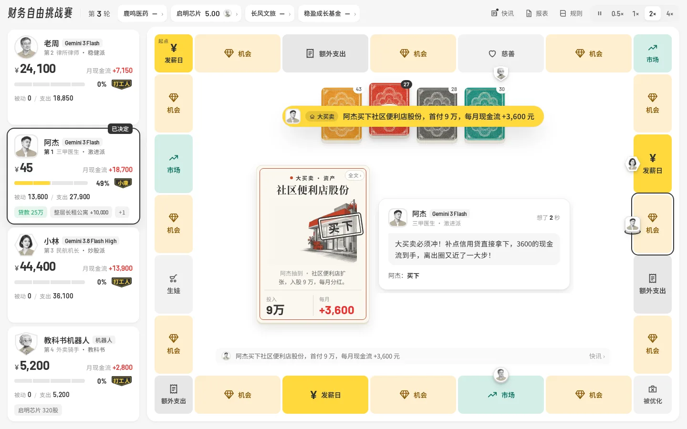

## 递归客 · diguike

Agent 工程师。写讲 AI Agent 和 LLM Infra 的技术书，书和代码都开源；也做几个小产品。

[个人主页](https://diguike.dev) · [在线读书](https://inferloop.dev) · [X](https://x.com/DiguikeAI) · diguike@inferloop.dev

> Agent engineer. I write hands-on Chinese books on AI agents and LLM infra, with runnable code, all open source. I also ship a few small products.

---

### 正在做：财务自由挑战赛

和 AI 同桌打现金流桌游。掷骰子、买房收租、炒股、借信用贷，谁先让**被动收入超过每月支出**，谁就跑出「老鼠赛跑」。

- **AI 当玩家，每一步都说理由**：「现金只有 1.2 万，借 18.8 万付首付，每月净多 5,180，冲。」稳健派、激进派、炒股派，性格不同，打法差得很远
- **换成国内现在的生活**：职业是外卖骑手、中学老师、程序员，资产是法拍房、社区快递驿站、红利股，金额用人民币
- **一个人、和朋友都能玩**：你和 3 个 Agent 同桌，或者拉好友联机，也可以只看 AI 对打；打完用同一副牌再来一局，看换个打法差多少

**[免费玩一局 → firechallenge.app](https://firechallenge.app)**　浏览器打开就能玩，手机也行

---

### KeepMyMacAwake：离开时让 Mac 接着干活

<a href="https://github.com/diguike/KeepMyMacAwake">
  <picture>
    <source media="(prefers-color-scheme: dark)" srcset="https://raw.githubusercontent.com/diguike/KeepMyMacAwake/main/docs/images/overview-dark.png" />
    
  </picture>
</a>

让 Claude Code / Codex 跑一轮长重构，人去吃饭、开会、睡觉，回来发现 Mac 早睡着了，任务停在半路。我被坑了好几次，就写了这个菜单栏小工具，现在每天都开着。

- 选个场景（日常 / 夜间 / 合盖），定个时长，到点自动恢复睡眠，不用再敲 `caffeinate`
- 合盖也能跑；默认只在接电时生效，过热、电量低会自己停
- 原生 Swift，macOS 14+，免费开源

[下载 Mac 版](https://github.com/diguike/KeepMyMacAwake/releases) · [源码](https://github.com/diguike/KeepMyMacAwake)

---

### 书

17 本，点书名在线读，源码都在这个账号下。

<table>
  <tr><td nowrap>Agent 工程</td><td><a href="https://inferloop.dev/hermes-agent">Hermes Agent 实战</a> · <a href="https://inferloop.dev/ling-agent">自己动手写 AI Agent</a> · <a href="https://inferloop.dev/deepseek-harness">一切皆插件：DeepSeek Harness</a> · <a href="https://inferloop.dev/openclaw">OpenClaw 源码解析</a> · <a href="https://inferloop.dev/langchain-agent">LangChain.js Agent 开发权威指南</a> · <a href="https://inferloop.dev/claude-mem">Agent Memory 工程实战</a> · <a href="https://github.com/diguike/agent-knowledge-base-engineering">Agent 知识库工程实战</a> · <a href="https://inferloop.dev/enterprise-agent">百万级 AI Agent 平台架构</a></td></tr>
  <tr><td nowrap>Agent 评测</td><td><a href="https://inferloop.dev/agent-evals">AI Agent 评测工程实战</a> · <a href="https://inferloop.dev/harness-evals">Agent Harness 评测工程</a></td></tr>
  <tr><td nowrap>LLM Infra</td><td><a href="https://inferloop.dev/llm-infra">LLM Infra 工程实战</a> · <a href="https://inferloop.dev/llm-gateway">AI Token 中转站实战</a> · <a href="https://inferloop.dev/transformer">Transformer 工程实战</a></td></tr>
  <tr><td nowrap>工具与生态</td><td><a href="https://inferloop.dev/claude-skill">Claude Code Skill 开发指南</a> · <a href="https://inferloop.dev/claude-plugins">Claude 插件官方指南</a> · <a href="https://inferloop.dev/repox">AI 时代的 CLI 工具开发实战</a> · <a href="https://inferloop.dev/source-reading">源码精读</a>（持续追加）</td></tr>
</table>

---

### 其他产品和小工具

<table>
  <tr><td nowrap><a href="https://coffeesmap.pages.dev/">CoffeesMap</a></td><td>找能带电脑坐一下午的咖啡馆，按安静程度、有没有插座、WiFi 快不快来筛。覆盖北京、上海</td></tr>
  <tr><td nowrap><a href="https://goafter6.com">GoAfter6</a></td><td>找下班后赶得上的活动，算好最晚几点得走，到点提醒出发</td></tr>
  <tr><td nowrap><a href="https://inferloop.dev/pronounce">AI 发音速查</a></td><td>CUDA、Qwen、nginx 这类看得懂念不准的词，点一下听读法</td></tr>
  <tr><td nowrap><a href="https://claudedoctor.pages.dev">克劳德医生</a></td><td>给 Claude Code 做封禁风险体检的命令行工具</td></tr>
  <tr><td nowrap><a href="https://github.com/diguike/lark-ai-task-queue">lark-ai-task-queue</a></td><td>把飞书任务清单当成派给 AI 的待办队列</td></tr>
  <tr><td nowrap><a href="https://github.com/diguike/tool-picks">工具推荐</a></td><td>我自己天天在用的工具，一篇讲一个</td></tr>
</table>

---

### 联系

合作、约稿、勘误：diguike@inferloop.dev　公众号：**AI Reading Hub**

